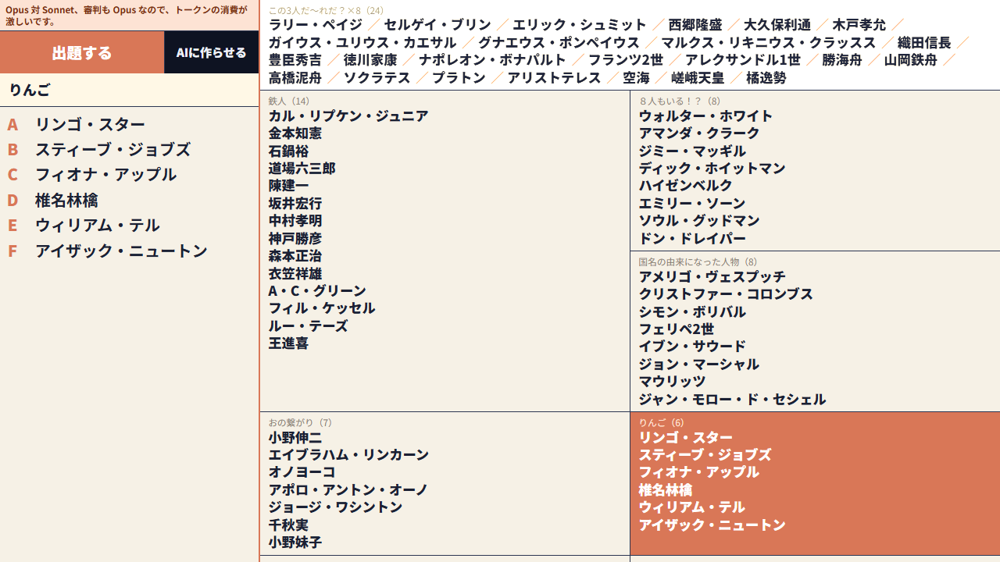
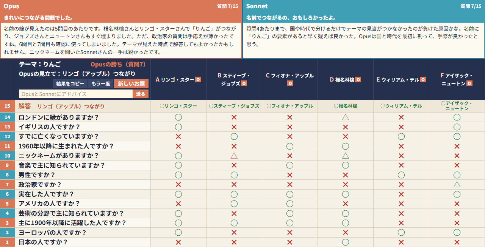

# 複数人アテルーヨー

あなたが「この〇人、だ～れだ？」のお題を出しClaudeのOpusとSonnetが対戦するのを見守るだけのゲームです。審判もOpusです。

 

**Claude artifactで遊ぶ:** https://claude.ai/artifact/4Z2f7uuA5g6AGQ7fqJGy6R 
Claudeにログインして開いてください。Claudeを用いない場合は簡易AIなので質問も回答も無茶苦茶です。
1局でclaudeを約60回呼ぶので、あなたのClaudeの使用量を多く使用します。

## 自分の PC で遊ぶ（立ち絵つき）
`claude` コマンド（[Claude Code](https://claude.com/claude-code)）と Python 3.10 以上が要ります。

```
python server.py
```

Windows は `アテルーヨー.bat` でも起動できます。

## メモ
- Claudeの蒸留対策に抵触しないように注意して作られています。
- Anthropic の公式のものではありません。

[MIT](LICENSE)
